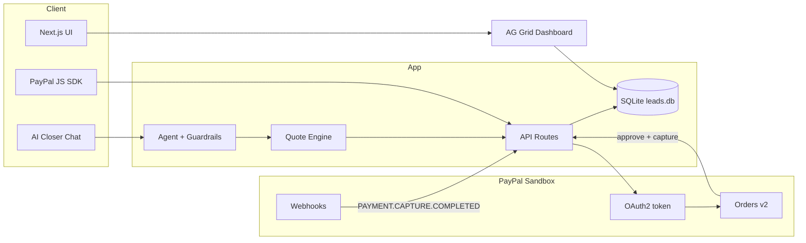

# AutoAI Lead Pay

[](LICENSE)

> **Built during the hackathon period (Oct 1 – Nov 12, 2026)** for the [PayPal AI Hackathon on Devpost](https://paypalaihackathon.devpost.com/). PayPal **sandbox only**.

**Live demo:** [https://pay.autoailead.com](https://pay.autoailead.com) (PayPal sandbox).

**AutoAI Lead Pay** is a full-cycle **AI sales closer** for agencies and small businesses in the US and LatAm. It is not an appointment setter: one conversation qualifies the lead, answers objections within real business rules, produces a quote, and collects the **deposit via PayPal**—then marks the lead **paid** and starts onboarding when PayPal confirms payment.

## Why PayPal is central (not decorative)

PayPal is the payment and trust layer of the product—not a footer logo.

| PayPal capability | Role in AutoAI Lead Pay |
|-------------------|-------------------------|
| **Orders v2 – Create** | Server creates a deposit order tied to the lead and quote (`POST /api/paypal/orders`). |
| **Orders v2 – Approve** | Buyer approves via PayPal Smart Buttons or redirect to PayPal’s `approve` link. |
| **Orders v2 – Capture** | Server captures funds after approval (`PUT /api/paypal/orders` or `/checkout/return`). |
| **Webhooks + verification** | `POST /api/webhooks/paypal` calls PayPal’s verify-signature API (`PAYPAL_WEBHOOK_ID`) on `PAYMENT.CAPTURE.COMPLETED` and updates lead status to **paid**. |

All API calls target **`https://api-m.sandbox.paypal.com`** in hackathon configuration.

## What it does

1. **Chat** — AI closer (rule-based demo or optional OpenAI-compatible LLM) qualifies service, budget, and timing.
2. **Objections** — Price, trust, and timing handled with verified playbook copy; quotes cannot exceed configured max discounts.
3. **Quote** — Guardrailed catalog pricing and 40% deposit.
4. **Checkout** — PayPal Orders v2 (buttons or redirect).
5. **Paid + onboarding** — Capture and/or verified webhook sets status to `paid` and advances onboarding.
6. **Dashboard** — AG Grid table of leads, quotes, orders, and payment state.

## Architecture



## AI tools used

| Tool | Use |
|------|-----|
| **Cursor (Cloud Agent)** | Application design, implementation, tests, and documentation. |
| **Optional `LLM_API_KEY`** | OpenAI-compatible chat for natural language when configured; otherwise a deterministic rule-based closer for demo and judging without API keys. |

No paid third-party services are required beyond optional LLM calls and PayPal sandbox.

## Quick start (demo mode — no secrets)

**Node.js 20+**

```bash
npm install
npm run dev
```

Open [http://localhost:43123](http://localhost:43123). With no credentials, **Demo mode** is on: mock orders and simulated webhook.

Flow: chat → quote → **Pay with PayPal (demo)** → **Dashboard** shows `paid`.

## Setup (PayPal sandbox)

1. Copy env template (names only—**never commit** `.env.local`):

   ```bash
   cp .env.example .env.local
   ```

2. Set these in `.env.local` or your host dashboard (**values not listed here**):

   | Variable | Purpose |
   |----------|---------|
   | `PAYPAL_SANDBOX_CLIENT_ID` | Sandbox REST app Client ID |
   | `PAYPAL_SANDBOX_CLIENT_SECRET` | Sandbox REST app Secret |
   | `PAYPAL_WEBHOOK_ID` | Webhook ID after registering your webhook URL |
   | `APP_URL` | Public base URL (return/cancel URLs and webhook registration) |
   | `LLM_API_KEY` | Optional — OpenAI-compatible key |
   | `LLM_BASE_URL` | Optional — API base |
   | `LLM_MODEL` | Optional — model name |
   | `DEMO_MODE` | Optional — `true` forces mock PayPal |

3. Register webhook: `https://<APP_URL>/api/webhooks/paypal` → event **`PAYMENT.CAPTURE.COMPLETED`**.

4. Verify CLI (prints **order ID and status only**):

   ```bash
   npm run smoke:sandbox
   ```

## Scripts

| Command | Description |
|---------|-------------|
| `npm run dev` | Dev server on port **43123** |
| `npm run build` | Production build |
| `npm run start` | Production server (port **43123**) |
| `npm test` | Vitest (quotes, webhooks, payment lifecycle) |
| `npm run smoke:sandbox` | Sandbox OAuth + Orders v2 create smoke test |

## Deploy on Render

[`render.yaml`](render.yaml) defines a **Web Service**:

| Setting | Value |
|---------|--------|
| **Build** | `npm ci && npm run build` |
| **Start** | `npm run start` |
| **Health check** | `/` |

Steps:

1. Connect this **private** GitHub repo in [Render](https://render.com).
2. Use **Blueprint** / `render.yaml` or create a Node web service with the same build/start commands.
3. Set secret env vars in Render (**`PAYPAL_SANDBOX_*`**, `PAYPAL_WEBHOOK_ID`, `APP_URL`, optional `LLM_API_KEY`).
4. Set `APP_URL` to your `https://<service>.onrender.com` URL and update PayPal app return URLs and webhook.

SQLite data is stored on the instance filesystem (`./data/`); for production persistence, plan a managed volume or database migration.

## Judge sandbox buyer account

> **TODO (maintainer):** Add PayPal Developer → Sandbox → **Personal / Buyer** test credentials here before judges test live Smart Buttons. **Do not commit real passwords to git**—prefer sharing via Devpost “testing credentials” field if the rules allow, and keep README to placeholders only.

| Role | Email | Password |
|------|-------|----------|
| Sandbox buyer | `TODO@sandbox.paypal.com` | `TODO` |
| Notes | | Use with PayPal sandbox checkout only |

Judges can also use **demo mode** (no PayPal login) to complete the full UI flow.

## Documentation

| File | Purpose |
|------|---------|
| [`docs/DEVPOST.md`](docs/DEVPOST.md) | Devpost submission copy |
| [`docs/VIDEO-SCRIPT.md`](docs/VIDEO-SCRIPT.md) | ≤2:30 demo video script |
| [`docs/DEMO_SCRIPT.md`](docs/DEMO_SCRIPT.md) | Extended beat sheet |

## Security

- Repository contains **`.env.example` only** (placeholder names).
- Scan: `gitleaks detect --source . --verbose`

## Sponsor fit

- **PayPal** — Orders v2 + verified webhooks  
- **AG Grid** (community) — leads dashboard  
- **Render** — `render.yaml` deploy  

## License

MIT — see [LICENSE](LICENSE).
